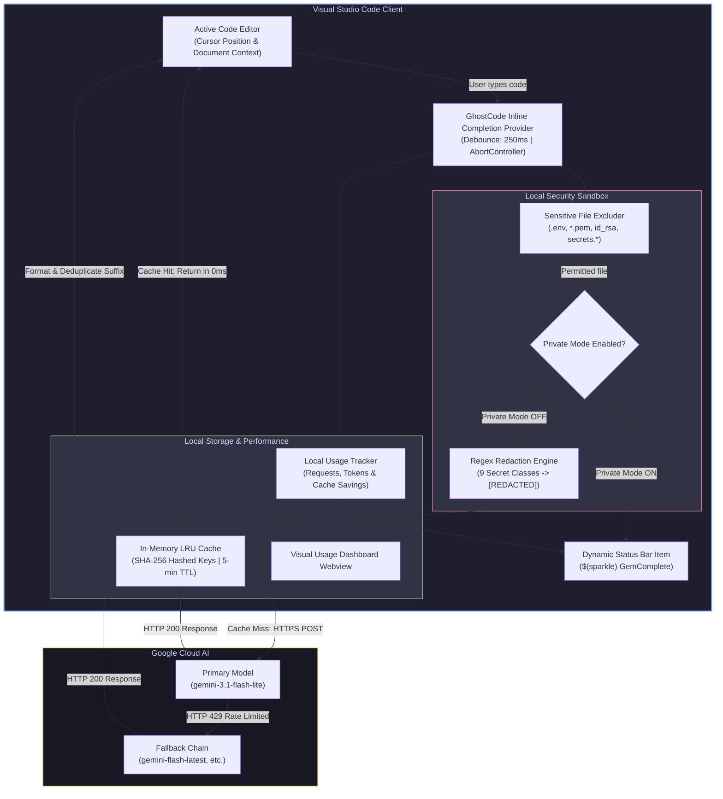
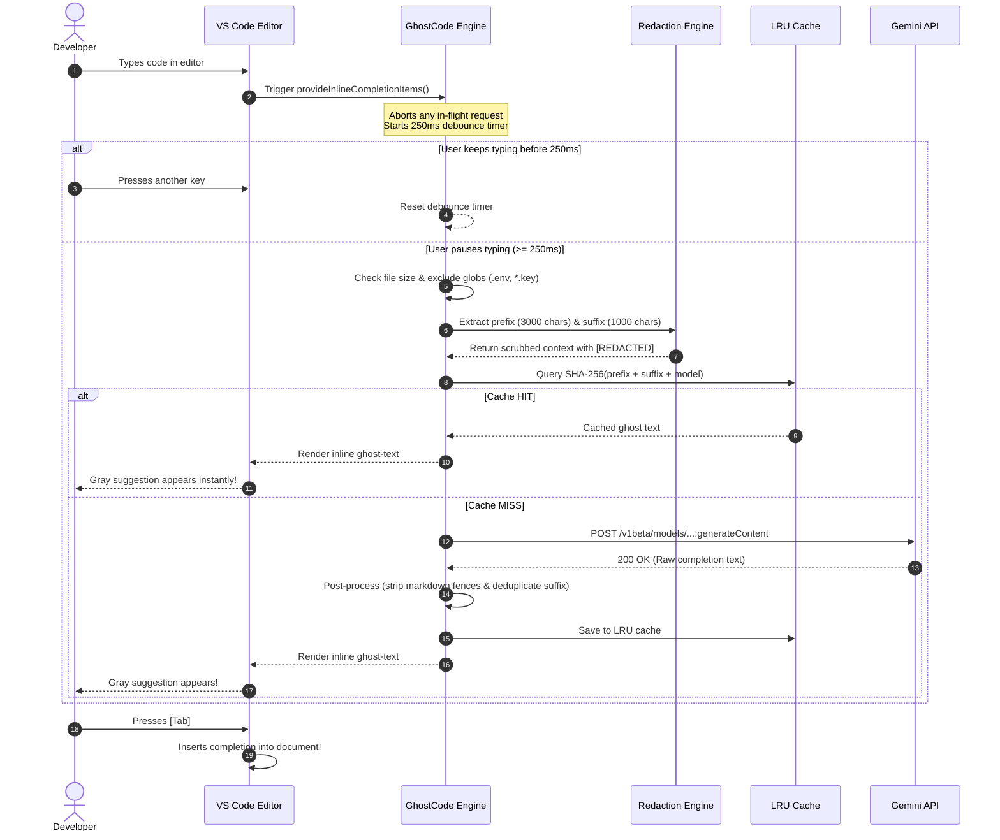
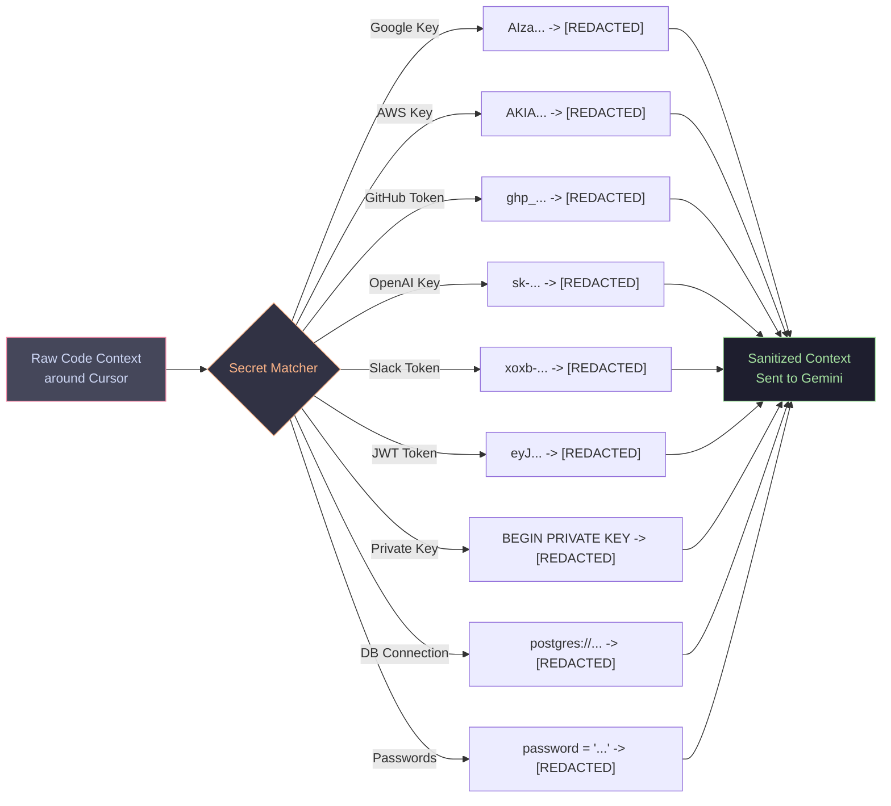
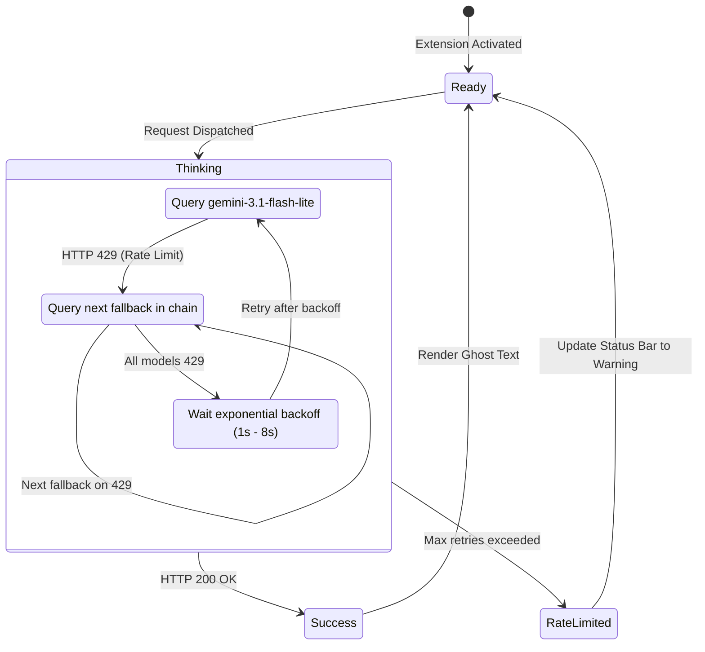

# GhostCode 👻⚡: AI Inline Code Completion (Gemini)

<p align="center">
  
</p>

<p align="center">
  <strong>Next-Gen AI Inline Code Completion for Visual Studio Code powered by Google Gemini API.</strong><br>
  <em>A fast, lightweight, and security-first GitHub Copilot alternative with zero runtime dependencies.</em>
</p>

<p align="center">
  <a href="https://github.com/Mayank2014l/GhostCode/blob/main/LICENSE"></a>
  <a href="https://github.com/Mayank2014l/GhostCode"></a>
  <a href="https://aistudio.google.com/"></a>
  <a href="https://github.com/Mayank2014l/GhostCode"></a>
  <a href="https://github.com/Mayank2014l/GhostCode/actions"></a>
  <a href="https://github.com/Mayank2014l/GhostCode"></a>
</p>

---

## 📑 Table of Contents

- [🌟 Overview](#-overview)
- [📱 How to Run & Install on Any Device (Step-by-Step)](#-how-to-run--install-on-any-device-step-by-step)
  - [🔑 Step 1: Get Your Free Google Gemini API Key](#-step-1-get-your-free-google-gemini-api-key)
  - [⚡ Method 1: Instant VSIX Install (Zero Node.js Required)](#-method-1-instant-vsix-install-recommended-for-any-device)
  - [💻 Method 2: Run from Source Code (Developer / Debug Mode)](#-method-2-run-from-source-code-developer--debug-mode)
  - [📦 Method 3: Build & Package Your Own `.vsix`](#-method-3-build--package-your-own-vsix)
- [🏗️ System Architecture & Charts](#-system-architecture--charts)
  - [1. High-Level System Architecture](#1-high-level-system-architecture)
  - [2. Keystroke to Ghost-Text Sequence Diagram](#2-keystroke-to-ghost-text-sequence-diagram)
  - [3. Security & Redaction Pipeline](#3-security--redaction-pipeline)
  - [4. Model Fallback & Rate-Limit State Machine](#4-model-fallback--rate-limit-state-machine)
- [✨ Key Features](#-key-features)
- [📊 Visual Usage Dashboard](#-visual-usage-dashboard)
- [⚙️ Configuration Settings](#️-configuration-settings)
- [⌨️ Command Palette Reference](#️-command-palette-reference)
- [🛡️ Security, Privacy & Consent](#️-security-privacy--consent)
- [❓ Troubleshooting & FAQ](#-troubleshooting--faq)
- [📄 License](#-license)

---

## 🌟 Overview

**GhostCode** brings smooth, multi-line ghost-text suggestions directly to your editor as you type. When you pause, intelligent suggestions appear in faint grey inline text. Pressing <kbd>Tab</kbd> instantly accepts the completion; typing anything else dismisses it cleanly.

### Why GhostCode?
- ⚡ **Zero Runtime Dependencies**: Uses Node 18+ native `fetch` — fast load times, minimal memory footprint, and zero dependency vulnerabilities.
- 🔒 **Security-First Architecture**: 9 built-in regular expression rules scrub API keys, AWS credentials, JWTs, and database URLs to `[REDACTED]` before leaving your computer.
- 🚀 **Smart Throttling & Caching**: Fast 250ms debouncing, automatic keystroke cancellation (`AbortController`), and an in-memory SHA-256 LRU cache prevent duplicate requests.
- 🔄 **Resilient Model Fallback**: If the primary model hits rate limits (HTTP 429), GhostCode smoothly switches to fallback models (`gemini-flash-latest`, `gemini-3.8-flash`, `gemini-3.5-flash`) without interruption.

---

## 📱 How to Run & Install on Any Device (Step-by-Step)

Want to install and run GhostCode on your laptop, desktop, Mac, Windows, or Linux machine? Follow these simple steps:

### 🔑 Step 1: Get Your Free Google Gemini API Key

GhostCode uses the official Google Gemini API. Google provides **free API access** with generous rate limits.

1. Go to **[Google AI Studio (Get API Key)](https://aistudio.google.com/apikey)**.
2. Sign in with your Google account.
3. Click the **"Create API Key"** button.
4. Copy your newly created API key (it begins with `AIzaSy...`). Keep this safe!

---

### ⚡ Method 1: Instant VSIX Install (Recommended for Any Device)

*No Node.js or development environment required! Works directly in any standard VS Code installation.*

#### A. Download the Extension File
Download the pre-packaged `.vsix` file from the repository:
- **Direct Download Link**: [Download `gemcomplete-0.1.1.vsix`](https://github.com/Mayank2014l/GhostCode/raw/main/gemcomplete-0.1.1.vsix)
- Or clone/download this GitHub repo:
  ```bash
  git clone https://github.com/Mayank2014l/GhostCode.git
  ```
  The file `gemcomplete-0.1.1.vsix` is included directly in the root directory!

#### B. Install into VS Code

**Option A (Using VS Code UI):**
1. Open Visual Studio Code.
2. Open the Extensions sidebar:
   - **Windows/Linux**: Press <kbd>Ctrl</kbd> + <kbd>Shift</kbd> + <kbd>X</kbd>
   - **macOS**: Press <kbd>Cmd</kbd> + <kbd>Shift</kbd> + <kbd>X</kbd>
3. Click the **three dots (`...`)** at the top right of the Extensions panel ("Views and More Actions").
4. Select **"Install from VSIX..."**.
5. Browse and select the downloaded `gemcomplete-0.1.1.vsix` file.
6. A notification will appear in the bottom-right: *"Completed installing extension..."*.

**Option B (Using Terminal / Command Prompt):**
```bash
code --install-extension gemcomplete-0.1.1.vsix
```

#### C. Set Your API Key & Start Coding!
1. In VS Code, open the Command Palette:
   - **Windows/Linux**: <kbd>Ctrl</kbd> + <kbd>Shift</kbd> + <kbd>P</kbd>
   - **macOS**: <kbd>Cmd</kbd> + <kbd>Shift</kbd> + <kbd>P</kbd>
2. Type and select: **`GemComplete: Set API Key`**.
3. Paste your Gemini API key (from Step 1) into the secure password prompt and press <kbd>Enter</kbd>.
4. A consent banner will appear explaining that code snippets are sent to Gemini. Click **"I Agree"**.
5. Look at the bottom Status Bar — you will see **`$(sparkle) GemComplete`**!
6. Open any code file (e.g., `main.py`, `app.ts`, `index.js`).
7. Start typing a function:
   ```typescript
   // Function to calculate fibonacci numbers
   function fibonacci(n: number): number {
   ```
8. Pause for a moment. You will see gray ghost-text suggestions appear!
9. Press <kbd>Tab</kbd> to accept! 🎉

---

### 💻 Method 2: Run from Source Code (Developer / Debug Mode)

If you want to contribute, modify, or test the source code live:

#### Prerequisites
- [Node.js](https://nodejs.org/) (version 18.0 or higher)
- [Visual Studio Code](https://code.visualstudio.com/)
- [Git](https://git-scm.com/)

#### Steps:
1. **Clone the Repository**:
   ```bash
   git clone https://github.com/Mayank2014l/GhostCode.git
   cd GhostCode
   ```

2. **Install Dependencies**:
   ```bash
   npm install
   ```

3. **Build the Extension**:
   ```bash
   npm run build
   ```
   *(Or run `npm run watch` if you want automatic rebuilds on file changes).*

4. **Launch Extension Development Host**:
   - Open the `GhostCode` directory in VS Code:
     ```bash
     code .
     ```
   - Press <kbd>F5</kbd> (or open the **Run & Debug** panel and click **"Run GemComplete Extension"**).
   - A new VS Code window titled **"[Extension Development Host]"** will open.
   - In that new window, set your API key via `Ctrl+Shift+P` -> `GemComplete: Set API Key`.
   - Enjoy live testing!

5. **Run the Test Suite**:
   ```bash
   npm test
   ```
   All 34 automated unit and integration tests will run and validate the cache, redaction engine, context filters, and prompt formatters.

---

### 📦 Method 3: Build & Package Your Own `.vsix`

You can package a standalone `.vsix` installer from source at any time:

```bash
# 1. Install dependencies and build
npm run package
```
This triggers the esbuild production bundle and creates `gemcomplete-0.1.1.vsix` ready to be shared with friends or colleagues!

---

## 🏗️ System Architecture & Charts

### 1. High-Level System Architecture

The following diagram illustrates how GhostCode operates inside VS Code and interacts with the Google Gemini API while maintaining local privacy:



---

### 2. Keystroke to Ghost-Text Sequence Diagram

Here is the exact lifecycle from the moment you hit a key to ghost-text rendering:



---

### 3. Security & Redaction Pipeline

GhostCode is built with a zero-compromise approach to data privacy. Any code sent to Gemini undergoes pre-transmission sanitization:



---

### 4. Model Fallback & Rate-Limit State Machine

Free-tier API limits are handled gracefully without annoying popups or interrupted workflows:



---

## ✨ Key Features

| Feature | Description |
| :--- | :--- |
| **Multi-Line Ghost Text** | Suggestions appear right in your active line in subtle gray text. Press <kbd>Tab</kbd> to accept. |
| **All Programming Languages** | Supports TypeScript, JavaScript, Python, Go, Rust, C/C++, Java, PHP, C#, HTML, CSS, SQL, Shell, and more. |
| **Zero Runtime Dependencies** | No bloated `node_modules` loaded at runtime. Built purely on Node 18+ native `fetch`. |
| **Ultra-Fast LRU Cache** | SHA-256 hashed queries cache responses for 5 minutes, avoiding repeat queries and saving API quota. |
| **Instant Keystroke Abort** | As soon as you type the next letter, previous requests are aborted via `AbortController`. |
| **Smart Trigger Filters** | Suppresses calls in empty files, whitespace-only changes, or files exceeding the 1MB limit. |
| **One-Click Private Mode** | Toggle Private Mode anytime to block all outgoing network requests instantly. |
| **Visual Usage Dashboard** | Interactive webview dashboard showing total requests, cache hits, token usage, and quota bar. |

---

## 📊 Visual Usage Dashboard

GhostCode includes a built-in interactive dashboard to monitor your Gemini API usage, rate limit quotas, and cache savings:

1. Press <kbd>Ctrl</kbd> + <kbd>Shift</kbd> + <kbd>P</kbd> (or <kbd>Cmd</kbd> + <kbd>Shift</kbd> + <kbd>P</kbd> on macOS).
2. Select **`GemComplete: Open Visual Usage Dashboard`**.
3. View:
   - **Total Completions Generated**
   - **Cache Hit Rate & Percentage of API Quota Saved**
   - **Daily Requests vs. Daily Quota Limit**
   - **Estimated Output Tokens Generated**
   - Quick Action buttons to Reset Statistics or Clear Cache.

---

## ⚙️ Configuration Settings

Customize GhostCode in VS Code Settings (`Ctrl+,` or `Cmd+,` and search for `gemcomplete`):

| Setting | Type | Default | Description |
| :--- | :--- | :--- | :--- |
| `gemcomplete.enabled` | `boolean` | `true` | Enable or disable inline code completions. |
| `gemcomplete.model` | `string` | `"gemini-3.1-flash-lite"` | Primary Gemini model ID. |
| `gemcomplete.fallbackModels` | `string[]` | `["gemini-flash-latest", "gemini-3.8-flash", "gemini-3.5-flash"]` | Fallback models queried if primary is rate-limited. |
| `gemcomplete.debounceMs` | `number` | `250` | Milliseconds to wait after last keystroke before querying. |
| `gemcomplete.maxPrefixChars` | `number` | `3000` | Code characters before cursor sent as context. |
| `gemcomplete.maxSuffixChars` | `number` | `1000` | Code characters after cursor sent as context. |
| `gemcomplete.maxOutputTokens`| `number` | `128` | Maximum length of generated code suggestions. |
| `gemcomplete.temperature` | `number` | `0.2` | Creativity level (0.0 = deterministic, 1.0 = creative). |
| `gemcomplete.privateMode` | `boolean` | `false` | When true, completely disables network queries. |
| `gemcomplete.disabledLanguages` | `string[]` | `["plaintext", "markdown", "scminput"]` | Languages where completions are disabled. |
| `gemcomplete.excludeGlobs` | `string[]` | `["**/.env*", "**/*.pem", "**/*.key", "**/id_rsa*", ...]` | Files never sent to API. |
| `gemcomplete.maxFileSizeKB` | `number` | `1000` | Max file size in KB eligible for completions. |

---

## ⌨️ Command Palette Reference

Access these commands via <kbd>Ctrl</kbd> + <kbd>Shift</kbd> + <kbd>P</kbd> (Windows/Linux) or <kbd>Cmd</kbd> + <kbd>Shift</kbd> + <kbd>P</kbd> (macOS):

| Command | Action |
| :--- | :--- |
| **`GemComplete: Set API Key`** | Stores your Gemini API Key in VS Code SecretStorage. |
| **`GemComplete: Clear API Key`** | Deletes your stored API key. |
| **`GemComplete: Toggle On/Off`** | Temporarily pauses or enables completions. |
| **`GemComplete: Toggle Private Mode`** | Toggles strict local mode (no network requests). |
| **`GemComplete: Open Visual Usage Dashboard`** | Launches the graphical metrics and quota dashboard. |
| **`GemComplete: View Usage Quota & Settings`** | Quick status modal with quota stats and quick actions. |
| **`GemComplete: Clear Cache`** | Flushes the in-memory LRU completion cache. |
| **`GemComplete: Show Output Log`** | Opens the extension output log channel for debugging. |
| **`GemComplete: Trigger Completion`** | Manually triggers an inline completion at current cursor. |

---

## 🛡️ Security, Privacy & Consent

1. **Explicit User Consent**: GhostCode never makes network calls until you explicitly click **"I Agree"** on first activation.
2. **Secret Storage**: Your API Key is stored using VS Code's encrypted native `SecretStorage` API (Windows Credential Manager / macOS Keychain / Linux Secret Service), never in plain text.
3. **Local Redaction**: Any text matching private keys, database passwords, or auth tokens is scrubbed before being dispatched.
4. **Untrusted Workspace Isolation**: If you open a folder in VS Code's Restricted Mode, GhostCode is completely disabled.
5. **No Telemetry**: No third-party analytics, user tracking, or telemetry scripts exist in this codebase.

---

## ❓ Troubleshooting & FAQ

### 1. Ghost text is not appearing when I type?
- **Verify API Key**: Press `Ctrl+Shift+P` -> `GemComplete: Set API Key` and re-enter your key.
- **Check Status Bar**: Look at the bottom bar. If it shows `$(circle-slash) Disabled`, click it or run `GemComplete: Toggle On/Off`.
- **Private Mode Active?**: If the status bar shows `$(lock) Private`, run `GemComplete: Toggle Private Mode` to disable it.
- **Check Output Log**: Run `GemComplete: Show Output Log` to see live logs and potential errors.

### 2. Can I use this completely free?
**Yes!** Google AI Studio provides a free tier for Gemini models with up to 15 requests per minute and 1,500 requests per day at zero charge. GhostCode's caching and debouncing keep you comfortably within this quota.

### 3. How do I install this on a friend's machine?
Simply send them the [`gemcomplete-0.1.1.vsix`](https://github.com/Mayank2014l/GhostCode/raw/main/gemcomplete-0.1.1.vsix) file. In their VS Code, have them press `Ctrl+Shift+X`, click `...` -> **"Install from VSIX..."**, and select the file! Then enter their free Gemini API key. Done in under 60 seconds!

---

## 📄 License

This project is licensed under the [MIT License](LICENSE).
Feel free to use, modify, and distribute it!

<p align="center">
  Made with ❤️ for developers who love fast, private, and intelligent coding.
</p>
